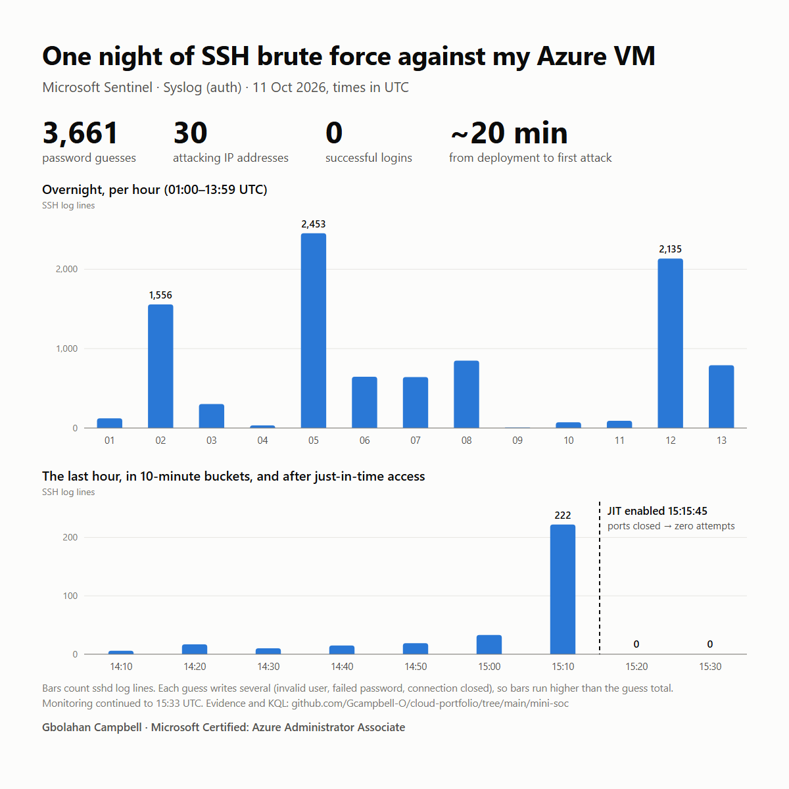

# Mini-SOC: Defender for Cloud + Microsoft Sentinel

I put two VMs on the internet with SSH and RDP open to everyone, watched real attackers find them, wrote a Sentinel detection that caught them, and closed the door with just-in-time VM access. Then I proved from the logs that the attacks stopped.

The environment is a lean version of Microsoft's official [Defender for Cloud lab](https://github.com/Azure/Microsoft-Defender-for-Cloud/tree/main/Labs/Modules). The attack data is real, from about 14 hours of exposure on 2026-10-10/11. Nothing was simulated.



## The result

| | |
|---|---|
| Time from deployment to first attack | **About 20 minutes** |
| SSH password guesses | **3,661** |
| Probes for usernames that don't exist | 3,134 |
| Distinct attacking IPs | **30** |
| RDP failed sign-ins | 4 (account `Test`, from 3 IPs) |
| **Successful logins** | **0** |
| Sentinel incidents raised and triaged | 12, all closed as **True positive** |
| SSH guesses in the hour before JIT | 100 |
| SSH guesses after JIT | **0** |

## What's in it

| Area | What was built |
|---|---|
| **Lab environment** | `labdeploy.bicep`: a Windows Server 2022 VM and an Ubuntu 22.04 VM with public IPs, an NSG allowing RDP and SSH from `*`, a Log Analytics workspace, Key Vault, a storage account that allows HTTP, and an Azure SQL Basic database. The weak settings are deliberate, so that Defender for Cloud has something to find |
| **Posture management** | Defender for Cloud paid plans on 30-day trials, including Servers Plan 2, Defender CSPM, Storage, Key Vault, Resource Manager and Databases. Inventory, recommendations and secure score reviewed |
| **Log collection** | Microsoft Sentinel on the workspace, with the **Syslog via AMA** connector (Linux `auth`/`authpriv`) and **Windows Security Events via AMA**. Each connector created a data collection rule and installed the Azure Monitor Agent on the VM |
| **Detection** | A custom scheduled analytics rule for SSH brute force, mapped to MITRE ATT&CK **T1110 Brute Force** |
| **Response** | Incident triage in Sentinel, then **just-in-time VM access** (Defender for Servers Plan 2) to close the management ports |
| **Evidence** | Query exports and the NSG rules before and after, in [`evidence/`](evidence/) |

## Timeline (UTC, 2026-10-11)

| Time | Event |
|---|---|
| 00:45 (approx.) | VMs come up with ports 22 and 3389 open to the internet |
| **01:06** | First SSH password guess |
| 02:00–13:21 | One `/24` block (`109.160.32.0/24`) rotates through six addresses. Each one fires about 1,000 sshd log lines in a 40–60 minute burst, sometimes two at once |
| 10:56–13:41 | 4 RDP sign-in failures on the Windows VM |
| **15:06** | My Sentinel rule fires for the first time: 12 alerts, 12 incidents |
| 15:15:05 | Last SSH attempt ever recorded |
| **15:15:45** | Just-in-time access enabled. Ports 22, 3389, 5985 and 5986 are now denied by default |
| 15:31 | All 12 incidents closed as True positive, with an analyst note |
| 15:33 | Heartbeat confirms the logs are still arriving, so the zero after JIT is real silence and not a broken pipeline |

## Detection: the Sentinel analytics rule

```kusto
Syslog
| where Facility in ("auth", "authpriv")
| where SyslogMessage has "Failed password"
| extend SourceIP = extract(@"from (\d{1,3}(?:\.\d{1,3}){3})", 1, SyslogMessage),
         TargetUser = extract(@"for (?:invalid user )?(\S+) from", 1, SyslogMessage)
| summarize FailedAttempts = count(), UsersTried = make_set(TargetUser, 10),
            FirstSeen = min(TimeGenerated), LastSeen = max(TimeGenerated)
            by SourceIP, Computer
| where FailedAttempts >= 10
```

- **Schedule:** runs every 5 minutes, alerts at 10 or more failures from one IP, and suppresses repeats for 1 hour after it fires.
- **Severity:** Medium.
- **Entity mapping:** `SourceIP` is mapped to an **IP** entity and `Computer` to a **Host** entity. That puts the attacker and the target right on the incident, so the analyst doesn't have to dig through raw logs.
- **Event grouping:** one alert per result row, so each attacking IP becomes its own alert with its own evidence.
- **Matching on `Failed password` only:** each SSH guess writes several sshd lines, so I counted one distinctive line per guess (see below).

**Triage, incident #1:** 420 failed passwords from `109.160.32.x6` against `asclab-linux` in under an hour, about one every 8 seconds. The usernames tried were generic list entries (`ubuntu`, `admin`, `user`, `deploy`…), not anything specific to this environment, and none succeeded. I classified all 12 incidents as **True positive**, because the attacks were real and the rule worked as designed. In production, the next steps would be blocking the source and closing the exposure, which is the next section.

## Response: just-in-time VM access

The NSG before and after enabling JIT ([`evidence/nsg-before-after-jit.txt`](evidence/nsg-before-after-jit.txt)):

| Priority | Before | After |
|---|---|---|
| 500 / 501 | `AllowRDP`, `AllowSSH` from `*` | *(moved)* |
| 1000 | | **JIT Deny** 22, 3389, 5985, 5986 to `asclab-linux` |
| 1001 | | **JIT Deny** 22, 3389, 5985, 5986 to `asclab-win` |
| 1002 / 1003 | | `AllowRDP`, `AllowSSH` (moved down from 500 and 501) |

JIT doesn't delete existing rules. It inserts Deny rules aimed at each VM's private IP and moves the old Allow rules to a lower priority, so the Denies win. When an admin needs access, they request it, and JIT adds a temporary Allow for **that admin's IP only**, for a set time. It then removes the Allow by itself.

**Before and after, in 10-minute buckets** ([`evidence/jit-before-after-10min.csv`](evidence/jit-before-after-10min.csv)):

| Bucket (UTC) | sshd lines | Password guesses |
|---|---|---|
| 14:10 | 6 | 3 |
| 14:20 | 17 | 7 |
| 14:30 | 10 | 4 |
| 14:40 | 15 | 8 |
| 14:50 | 19 | 9 |
| 15:00 | 33 | 10 |
| 15:10 (closed at 15:15:45) | 222 | 59 |
| **After 15:15:45** | **0** | **0** |

## What broke, and what it taught

**Counting the wrong thing**
- My first count said **9,727 attempts**. That was really the number of sshd *log lines*. One failed SSH guess writes several of them: `Invalid user`, `Failed password`, `Connection closed`. Counting only the `Failed password` lines gave the real number of guesses, 3,661. Three of the evidence files ([top source IPs](evidence/ssh-top-source-ips.csv), [usernames](evidence/ssh-usernames-tried.csv), [per hour](evidence/ssh-attempts-per-hour.csv)) were exported before I caught this. I kept them, because the *shape* of the data is still right, but renamed their column to `sshdLogLines` so nobody reads them as guesses. The blank rows in those files are lines where no IP or username could be extracted.
- **`first` is a reserved word in KQL.** Using it as a column name gave a `SYN0002` parse error. I renamed it to `firstSeen`.

**Sentinel**
- **Alert grouping turned 12 alerts into 12 incidents.** The rule's incident settings grouped alerts only when *all* entities matched. Every alert had a different attacker IP, so none of them grouped. One attack campaign against one host should be **one** incident, and grouping on the **Host** entity does that. Twelve tickets for one event is how alert fatigue starts.
- **I checked that "zero" was real.** "No attacks after JIT" only means something if the logs are still arriving. A non-attack log line at 15:33 proved the agent and the data collection rule were still working.

**Defender for Cloud**
- **Secure score showed 100%, while the Inventory showed 9 of 11 resources unhealthy.** The headline score and the risk ratings lag hours behind the individual assessments. The per-resource recommendations told the truth: on the Linux VM there were 7, including *"Management ports of virtual machines should be protected with just-in-time network access control"*, encryption at host, an EDR agent, backup, and system updates.
- **There are two Defender plans pages.** Environment settings shows both the subscription and the Log Analytics workspace, and the workspace has its own legacy plans page. Plans for VMs, storage and so on are turned on at the **subscription**.
- **The portal toggles didn't do exactly what I expected.**
  - The Databases toggle turned on four database types at once.
  - Resource Manager was missed.
  - Defender for Storage turned on malware scanning, which bills per GB scanned, by default.

  I fixed and confirmed all of these from the CLI:
  ```bash
  az security pricing create -n Arm --tier Standard
  az security pricing create -n StorageAccounts --tier Standard --subplan DefenderForStorageV2 \
    --extensions name=OnUploadMalwareScanning isEnabled=False --extensions name=SensitiveDataDiscovery isEnabled=True
  az security pricing list --query "value[].{plan:name, tier:pricingTier}" -o table
  ```
- **Servers Plan 2 installed Microsoft Defender for Endpoint on its own,** as the `MDE.Linux` and `MDE.Windows` VM extensions, with no action from me.
- **Defender raised no brute-force alerts of its own** in this window. Sentinel, with a rule I wrote, is what turned the raw logs into incidents.

**Building the environment**
- **`az bicep decompile` of Microsoft's ARM template gave errors** (string `dependsOn` values). I wrote a clean, smaller Bicep file instead of fixing the generated one.
- **Quota vs. capacity.** The lab's original small VM sizes failed: `Standard_B1ms` and `B2s` aren't offered in Central US for this subscription, and the Basv2 family had a quota of **0**. `az vm list-skus` (what's offered) and `az vm list-usage` (what I'm allowed) are different questions. I chose `Standard_D2als_v7`, which passed both.

## Changes from Microsoft's lab

| Change | Reason |
|---|---|
| Converted `labdeploy.json` to Bicep and cut it down | AKS, Container Registry, App Service and the Function App removed, taking the estimate from about $14/day to about $6.70/day. The modules I ran didn't need them |
| VM size `Standard_D2als_v7`, Windows image `2022-datacenter-azure-edition` | See quota vs. capacity above |
| A subset of Defender plans, not all of them | Only the plans that covered resources I'd deployed |
| SSH brute-force capstone instead of an Entra sign-in investigation | Using Entra ID sign-in logs in Sentinel needs Entra ID P1/P2 in that tenant |
| Sentinel run from the Defender portal | Sentinel in the Azure portal retires on March 31, 2027 |

**Not completed:** attack path analysis (Module 17) still showed 0 paths when I tore down, because Defender CSPM hadn't finished building its security graph after about 14 hours. Regulatory compliance and continuous export were reviewed but not worked through in depth. Adaptive application controls (Module 8) have been retired by Microsoft.

## Evidence

All public IP addresses in [`evidence/`](evidence/) have their last octet masked (`109.160.32.x1`, `109.160.32.x2`…). Each masked address stays consistent across files, and the `/24` is kept so the address rotation is still visible. Private addresses (`192.168.0.x`) are the lab's own VNet.

| File | What it shows |
|---|---|
| [`attack-timeline.png`](attack-timeline.png) (in `mini-soc/`) | The chart at the top of this page, built from `ssh-attempts-per-hour.csv` and `jit-before-after-10min.csv` |
| `ssh-attack-totals.csv` | Final totals: guesses, invalid-user probes, distinct IPs, successful logins, first and last attack |
| `jit-before-after-10min.csv` | The 10-minute buckets either side of JIT |
| `nsg-before-after-jit.txt` | The NSG rules before and after JIT |
| `sentinel-incidents.csv` | The 12 incidents, their classification and close time |
| `rdp-failed-signins.csv` | Windows Event ID 4625 failures (logon type 3, network) |
| `ssh-top-source-ips.csv`, `ssh-usernames-tried.csv`, `ssh-attempts-per-hour.csv` | Distribution by source, username and hour, in **log lines**, not guesses (see above) |

## Deploying this yourself

> ⚠️ This opens RDP and SSH to the entire internet on purpose. Expect real attacks within minutes. Use a long, random password and don't leave it running.

```bash
az group create --name asclab --location centralus
az deployment group what-if --resource-group asclab --template-file labdeploy.bicep --parameters password=<long-random-password>
az deployment group create --resource-group asclab --template-file labdeploy.bicep --parameters password=<long-random-password>
```

Check VM size availability *and* quota in your region first (`az vm list-skus`, `az vm list-usage`).

## Cost and teardown

The whole run (about 15 hours) cost about **$4–5**, almost all of it the two VMs. Defender for Cloud and Sentinel were on their free trials: 30 days per Defender plan, and 31 days for Sentinel on up to 10 GB/day.

```bash
az group delete --name asclab --yes --no-wait
# Defender plans bill automatically when the trial ends. Turn each one back to Free:
az security pricing create -n VirtualMachines --tier Free   # repeat for each plan you enabled
az security pricing list --query "value[?pricingTier=='Standard'].name" -o tsv
```

The Key Vault is soft-deleted rather than removed, so its name stays reserved. Run `az keyvault purge --name <kv-name>` before redeploying under the same name.

## Built with

Microsoft Defender for Cloud (Servers Plan 2, Defender CSPM, just-in-time VM access), Microsoft Sentinel (Content hub, data connectors, scheduled analytics rules, incidents), Azure Monitor Agent and data collection rules, Log Analytics and KQL, Network Security Groups, Azure Bicep, Azure CLI.
